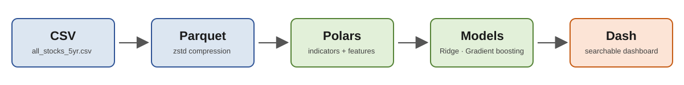

# Summary of technology choices for the S&P 500 stock price prototype



## Overview

This project takes five years of daily S&P 500 prices and turns them into next-day price forecasts that anyone can explore. The notebook stores the data efficiently, adds technical indicators, trains two prediction models, and shows the results in a dashboard where you can search for any company. This document explains why each technology was chosen over the alternatives, and where those alternatives would still be a good fit.

A quick note on method: nothing here was benchmarked, as agreed for this prototype. The recommendations come from how each tool is designed to work and from what is generally known about how it behaves as data grows. The current dataset (1x) is about 29 MB and 619,040 rows. That makes 10x roughly 290 MB and 6 million rows, and 100x roughly 2.9 GB and 62 million rows. At the larger sizes, the Parquet data would be partitioned (for example by year or ticker range) rather than kept in a single file. The notebook keeps one file because, at 1x, partitioning would add complexity without any benefit.

| Part | Chosen | Main reason |
| --- | --- | --- |
| 1. Storage | Parquet with zstd compression | Columnar, typed, compressed, and lets queries skip data they do not need. |
| 2. Data processing | Polars | Lazy, multi-threaded and memory-efficient, so the same code keeps working at 100x. |
| 2. Models | Ridge regression and gradient boosting | A simple, explainable baseline plus a model that can capture non-linear patterns. |
| 3. Dashboard | Dash (with Plotly) | Runs inside Jupyter, updates only what changes, and has interactive charts built in. |

## Part 1 – Storing and retrieving data: Parquet with zstd

### Why Parquet

Parquet stores data by column rather than by row. A query that only needs the date and closing price reads those two columns and ignores the rest. The file also records each column's data type, so dates and numbers do not have to be guessed and parsed again on every load. Each block of rows carries min and max statistics, which means a filter such as one ticker can skip whole blocks without reading them. Finally, Parquet is compressed, and it is understood by Polars, pandas, DuckDB, Spark and most other analytics tools, so the choice does not lock us in.

### Why zstd compression

Zstd gives a strong compression ratio while decompressing quickly, which is the combination that matters for data that is written once and read many times. Snappy is faster to write but produces larger files, so it is a fair choice only if write speed were the top priority. Gzip reaches a similar size to zstd but is noticeably slower to compress and decompress. Leaving the file uncompressed saves CPU time but wastes disk space and I/O, which become the bottleneck at larger scales.

### What we give up by not staying with CSV

CSV is readable in any text editor or Excel and needs no extra library, which is real value for a small file that people want to open and inspect. Its weaknesses show up as data grows: it is plain text with no compression, every column has to be read and parsed even when only one is needed, types must be inferred each time, and there are no statistics to skip data. All of this cost grows in direct proportion to file size.

### Recommendation by scale

| Scale | Approx. size | Recommendation |
| --- | --- | --- |
| 1x | 29 MB (CSV) | Both work and load quickly. Parquet is still preferred because it preserves types and costs nothing extra to adopt. |
| 10x | 290 MB (CSV) | Parquet. CSV still loads but repeated parsing becomes a visible delay, while Parquet stays quick and much smaller on disk. |
| 100x | 2.9 GB (CSV) | Parquet is clearly better. A CSV of this size must be fully parsed on each use, while Parquet allows column and ticker pruning and streaming. Partitioning the files becomes worthwhile here. |

### Partitioning for larger data

At 1x, a single Parquet file is the simplest and fastest option, so the notebook writes one file. If the data grows toward 10x or 100x, a partitioned Parquet dataset will be considered, split by year or by ticker range. Queries then open only the partitions they need, new data can be added as new files without rewriting old ones, and several files can be processed in parallel. Because Polars reads a partitioned folder with the same lazy scan used for a single file, the rest of the pipeline would not need to change.

**Limitation of the choice:** Parquet files are not human-readable and are not designed for appending a few rows at a time. New data is normally added as new files. For this dataset, which is updated in batches, that is not a problem.

## Part 2 – Manipulating data and building models

### Why Polars instead of pandas

Both libraries can do everything this assignment needs, and at the current 1x size either would finish quickly. The deciding factor is what happens at 10x and 100x.

- **Lazy execution.** Polars can plan a whole query before running it, reading only the columns and rows it needs. Pandas runs each step immediately and keeps every intermediate result.
- **Parallelism.** Polars uses all CPU cores by default. Pandas operations are mostly single-threaded.
- **Memory.** Polars is built on Apache Arrow and tends to need far less memory. Pandas commonly needs several times the dataset size in RAM, which at 100x becomes a real limit. Polars can also process data in streaming mode when it does not fit in memory.
- **A natural fit for this task.** Indicators have to be calculated separately for each company. Polars expresses this with window expressions such as `.over("name")`, which run in one optimised pass. The pandas equivalent often relies on groupby combined with apply, which is slower and wordier.

**Limitations of pandas for this project:** eager execution, higher memory use and little support for data larger than RAM. Pandas remains a better choice when a team already knows it well, or for the huge ecosystem of tutorials and tools built around it.

**Limitations of Polars:** it is younger, its API still changes more often, and the community is smaller. Some libraries expect pandas, although converting the data to NumPy for scikit-learn, as the notebook does, avoids any difficulty.

### Technical indicators

Four indicators were added to the data, all calculated per company: the 20-day simple moving average (SMA) and 20-day exponential moving average (EMA) to show trend, the 14-day Relative Strength Index (RSI) to show momentum and overbought or oversold conditions, and MACD with its signal line to show shifts in trend strength. Short return windows and relative volume were added as supporting inputs.

### Prediction models

The task is to predict the next day's closing price for every company. Two models were chosen:

- **Ridge regression.** A regularised linear model. It is fast, stable and easy to explain, and it sets a sensible baseline.
- **Gradient boosting (histogram-based).** A tree ensemble that can capture non-linear relationships between indicators and is still quick to train on hundreds of thousands of rows.

Rather than fitting 505 separate models, one model learns from all companies together. To make that possible, the models predict the next-day percentage change, using scale-free inputs such as RSI and price relative to its moving average, and the result is converted back into a price. Predicting raw prices would force the model to treat a $20 stock and a $1,000 stock as the same problem.

The 80/20 split is chronological: the models train on the earlier 80% of dates and are tested on the latest 20%. A random split would let the models see the future and give flattering but misleading results. A naive baseline (tomorrow equals today) is included for comparison.

**Limitations and how to read the results.** Daily stock prices behave very much like a random walk, so improvements over the naive baseline are usually small. A model that only matches or slightly beats the baseline is an expected outcome, not a bug. The models also use only price and volume history, with no news, earnings or market-wide information. Heavier alternatives such as per-company ARIMA or deep learning (LSTM) were not chosen because they multiply training cost across 505 companies and are unlikely to justify it on this data.

## Part 3 – Dashboard: Dash

Dash was chosen because it suits a notebook-based prototype and handles the "pick a ticker and update the charts" requirement cleanly. It runs directly inside Jupyter, so there is no separate app to set up. Its callback model refreshes only the charts that depend on the dropdown, and its Plotly charts give zoom, hover and range controls without extra work. The dropdown is searchable, which handles 505 tickers comfortably, and each update reads only the selected company's rows from the Parquet files, so response time does not degrade as the dataset grows. Dash is also built on Flask, so the same code can later be moved to a standalone script and deployed.

**Why not Streamlit:** it is the quickest tool to get started with and its code is shorter, but it runs as a separate script outside the notebook and re-executes the whole script on every interaction unless caching is carefully managed. It also gives less fine-grained control over what updates. It would be a perfectly reasonable choice for a simpler, single-page app.

**Why not Reflex:** it compiles Python into a React web app and needs its own project structure and Node tooling. That makes it powerful for full web applications but heavier than this prototype requires, and it is a younger project with fewer examples to draw on.

**Limitation of Dash:** callbacks and layout components take more code than Streamlit, and some knowledge of layout and styling is needed to polish the look.

## Details Explanation of the Notebook File

The notebook mirrors the three parts and each stage hands its output to the next. Raw CSV becomes Parquet, Parquet becomes indicators and forecasts, and the forecasts become the dashboard.

### From raw CSV to a query-ready Parquet file

This stage answers the storage question. The notebook reads `all_stocks_5yr.csv` from `data/csv/` and converts it to a zstd-compressed Parquet file in `data/parquet/`. The conversion is streamed, so the file is never loaded into memory all at once. To confirm nothing was lost, the notebook compares the CSV and Parquet file sizes and checks that the row count matches the 619,040 rows in the brief. It then retrieves a single ticker (AAPL) and four columns, which shows how targeted retrieval works and why the format suits the dashboard later on.

### From raw prices to next-day forecasts

This stage covers the analysis and modelling requirements, and it is built up in four steps.

**Preparing the data.** The Parquet file is loaded and filtered to rows that have a closing price and volume. Rows are then sorted by company and date, so every calculation that follows runs in time order.

**Adding the indicators.** Four technical indicators are added to the dataframe: SMA 20, EMA 20, RSI 14 and MACD with its signal line. That is double the two the assignment asks for. Each one is calculated separately for every company, so values never leak from one stock into another. Short returns and relative volume are added as supporting features, and the indicators are rescaled so that one model can learn from all 505 companies together.

**Framing the prediction problem.** The target is the next day's percentage change in the closing price. The first rows of each company, where the rolling windows are not yet full, are dropped. The final row of each company is set aside because it has no tomorrow yet, and it is used later for the true forecast. The data is then split 80/20 by date, with the earlier 80% used for training and the latest 20% for back-testing, as the assignment requires.

**Training and back-testing the models.** Ridge regression and gradient boosting are trained on the same features. Their predicted changes are converted back into prices and scored against the real next-day closes using RMSE, MAE and MAPE, next to a naive baseline. Finally, the notebook produces a next-day forecast for every company and saves the indicators, back-test predictions and forecasts as small Parquet files in `data/parquet/`.

### From forecasts to a searchable dashboard

This stage satisfies the requirement that predictions be available for every company. The dashboard reads the files saved in Part 2, so it never has to retrain anything. Choosing or typing a ticker in the dropdown updates three charts: actual against predicted prices over the test period with tomorrow's forecast marked, the closing price with its moving averages, and the RSI. A short line above the charts gives the last close, both forecasts and each model's test error for that company. Because every update reads only the selected company's rows, covering all 505 tickers does not slow it down.

## Running the notebook

Place `all_stocks_5yr.csv` in `data/csv/` inside the working directory and run the cells from top to bottom. The first cell installs `polars`, `pyarrow`, `scikit-learn`, `plotly` and `dash` if they are missing. The notebook only writes to `data/parquet/`, where it saves four Parquet files: the converted dataset, the indicator data, the back-test predictions and the next-day forecasts. The dashboard reads the last three, so it can be relaunched without retraining the models.

```text
working-directory/
├── stock_prediction_prototype.ipynb
└── data/
    ├── csv/
    │   └── all_stocks_5yr.csv
    └── parquet/
        ├── all_stocks_5yr.parquet
        ├── stocks_features.parquet
        ├── predictions_test.parquet
        └── forecast_next_day.parquet
```

### Possible next steps

- Partition the Parquet files by year or ticker range if the data reaches the 100x scale.
- Add more features, such as Bollinger Bands, market-wide indicators or sector information, and compare the models again against the naive baseline.
- Move the dashboard to a standalone script for deployment once the prototype is approved.

## Conclusion

This prototype shows that the full workflow, from raw CSV to an interactive dashboard, can be built with tools that will keep working as the data grows. Parquet with zstd keeps storage small and reads selective. Polars handles the indicator calculations in a single optimised pass. Ridge regression and gradient boosting give an easy-to-explain baseline alongside a more flexible model, and Dash lets anyone look up a company and see its predictions. The choices were made so that moving from 1x to 10x or 100x means running the same code on more data, not rewriting it.

It is fair to ask why this much care is needed for a dataset that currently fits in a few megabytes. Optimisation matters in general for a few reasons:

- **Data only gets bigger.** A choice that feels instant today can become the bottleneck later, and rebuilding a pipeline once it is in use costs far more than choosing well at the start.
- **Time and cost.** Faster loading and processing means less waiting for analysts and less spend on compute, memory and storage. Small savings per run add up when a job runs daily or across hundreds of companies.
- **Fast iteration.** When data loads and models train in seconds, people can try more ideas, fix mistakes sooner and trust the results more.
- **Reliability.** Pipelines that stay within memory limits are less likely to crash, and streaming and lazy evaluation make that possible on ordinary hardware.
- **Usability.** A dashboard that responds instantly gets used, while a slow one is quietly abandoned, however good the predictions behind it are.

Optimisation also has to be balanced against simplicity. At the current size, a plain CSV and pandas would have worked, and this document says so. The point is to pick tools that cost little extra now but leave room to grow, then measure properly when real scale arrives. The honest next step is to benchmark these choices at 10x and 100x, and to test whether richer features improve the models beyond the naive baseline.
